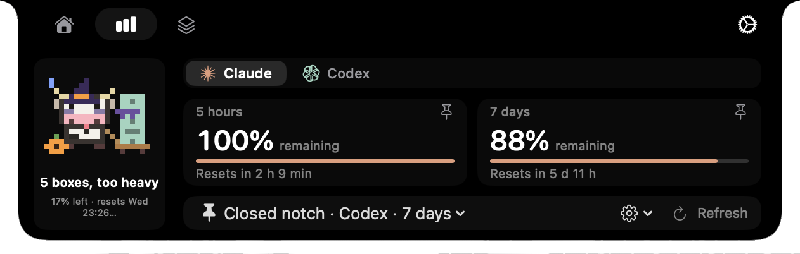
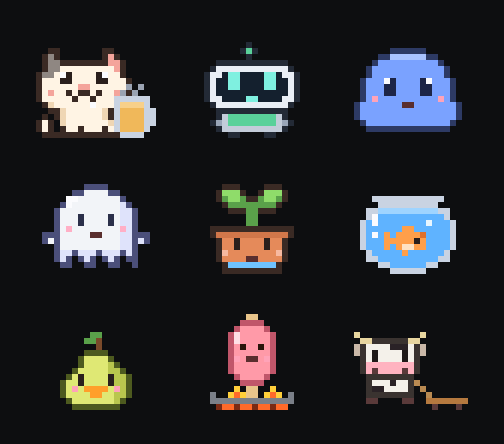
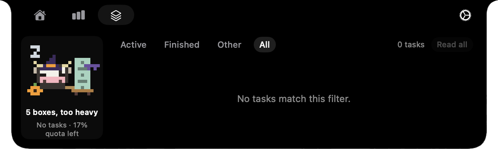

# QuotaNotch

AI quota, coding tasks, music and calendar in your MacBook notch, looked after by a small pixel pet.

[简体中文](README.zh-CN.md) · [Download](https://github.com/ApisXia/QuotaNotch/releases) · [Guide](docs/Guide.md)

## Nine pets that show your quota

Each pet shows the remaining quota in its own way: Mochi's tea runs low, Slacker's bowl drains, Duck Pear's mountain grows, BBQ'd gets more burnt, and Workhorse's cart fills with boxes. Pets react when you click them, celebrate when a task finishes, do something small now and then, and speak in their own words. They wear hats for Lunar New Year, Mid-Autumn, Halloween, Christmas and your birthday.

## Features

- **Quota:** Claude and Codex, with 5-hour and 7-day windows. Pin one to the closed notch. Low quota turns yellow, then red.
- **Tasks:** follow local Codex and Claude Code tasks across projects, see when one is waiting for you, and keep read history for 1 hour, 5 hours or 1 day.
- **Music:** controls for Now Playing, with cover art looked up when the app doesn't provide one.
- **Calendar:** events and reminders, a week view, and one-click links for Zoom, Google Meet, Teams, Tencent Meeting, Feishu and DingTalk.
- English and Simplified Chinese. Updates install from inside the app.

## Install

**macOS 15+ · Apple Silicon & Intel.** Download the DMG from [Releases](https://github.com/ApisXia/QuotaNotch/releases) and drag QuotaNotch into Applications. On first launch, connect Claude Code and Codex. Builds are ad-hoc signed and not Apple notarized.

[Usage and build guide](docs/Guide.md) · [GPL-3.0](LICENSE) · [Third-party notices](THIRD_PARTY_LICENSES)

Based on [Boring Notch](https://github.com/TheBoredTeam/boring.notch).
