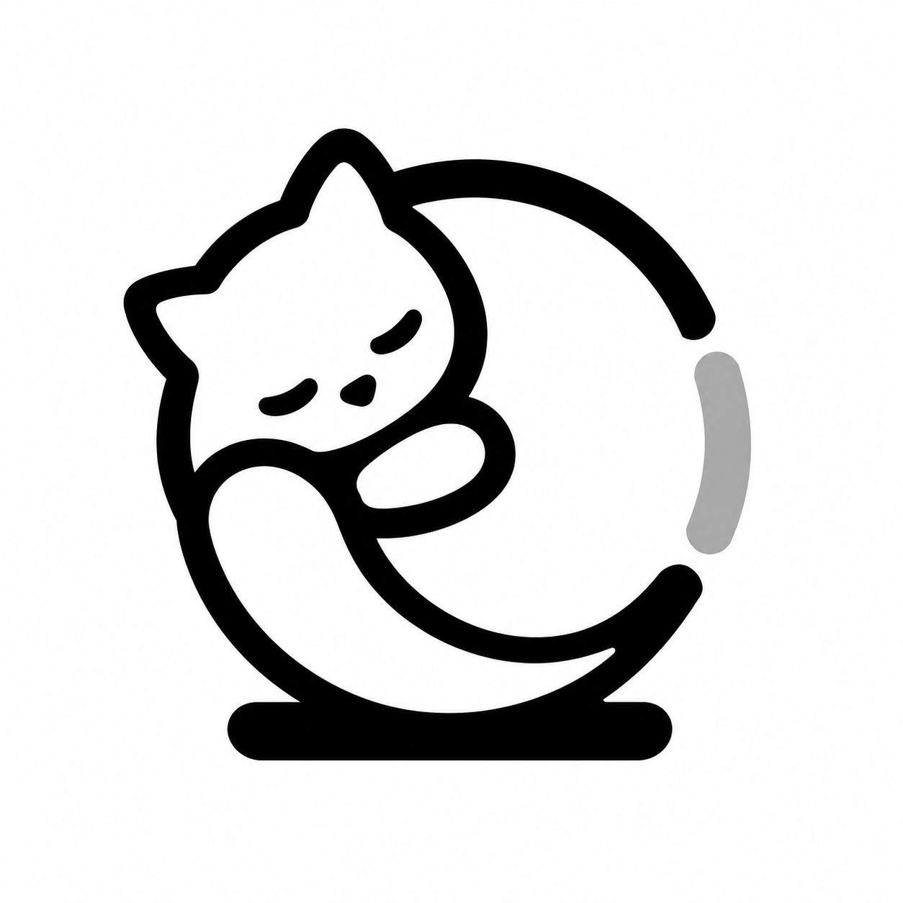
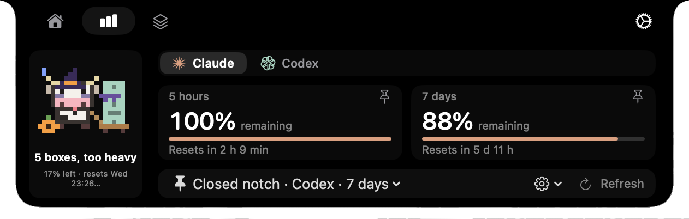
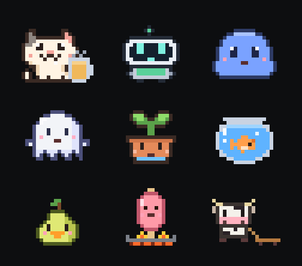
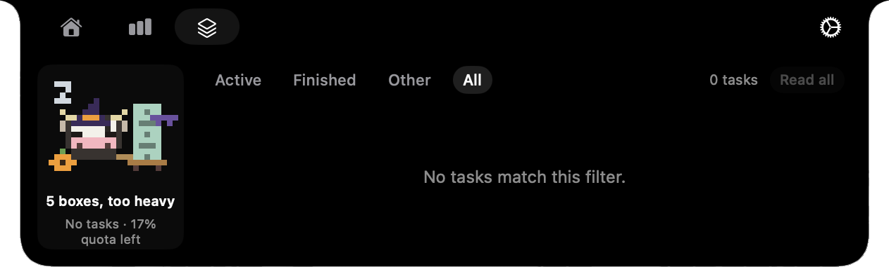

# QuotaNotch

在 MacBook 刘海里看 AI 额度、编程任务、音乐和日历，还有一只像素宠物陪着你。

[English](README.md) · [下载](https://github.com/ApisXia/QuotaNotch/releases) · [使用说明](docs/Guide.zh-CN.md)

## 九只会显示额度的宠物

每只宠物用自己的方式显示剩余额度：麻薯的茶越喝越少，摸鱼的鱼缸慢慢见底，鸭梨头上的山越来越大，芭比Q了越烤越焦，牛马车上的箱子越堆越多。点它会有反应，任务完成时会庆祝，闲着时偶尔自己动一动，还会用自己的话说额度。春节、中秋、万圣节、圣诞和你的生日会戴上小帽子。

## 功能

- **额度：** 支持 Claude 和 Codex 的 5 小时与 7 天额度，可以固定一个显示在收起的刘海上。额度不足时逐渐变黄、变红。
- **任务：** 按项目跟踪本机 Codex 和 Claude Code 任务，等你处理时会提醒；已读记录可保留 1 小时、5 小时或 1 天。
- **音乐：** 控制正在播放的音乐；应用没有提供封面时会自动查找。
- **日历：** 日程与提醒事项、周视图，Zoom、Google Meet、Teams、腾讯会议、飞书、钉钉会议一键加入。
- 支持中文和英语，可在应用内直接更新。

## 安装

**macOS 15+，支持 Apple Silicon 和 Intel。** 从 [Releases](https://github.com/ApisXia/QuotaNotch/releases) 下载 DMG，拖入「应用程序」。首次打开时按提示连接 Claude Code 和 Codex。安装包为临时签名，尚未 Apple 公证。

[使用与构建说明](docs/Guide.zh-CN.md) · [GPL-3.0](LICENSE) · [第三方许可](THIRD_PARTY_LICENSES)

基于 [Boring Notch](https://github.com/TheBoredTeam/boring.notch)。
